<div align="center">


<a href="https://github.com/Tepanniaky"></a>&nbsp;<a href="https://github.com/Tepanniaky?tab=followers"></a>&nbsp;

</div>


## 📡 Transmissão recebida

> **[ HOLOGRAMA · CANAL PRIVADO ]**
>
> Opa, porter! Aqui é o **Zé Filho**. Estudo **Sistemas de Informação** e transporto código de um nó a outro da rede: **web, mobile e APIs**.
> Meu trabalho é o mesmo de qualquer entregador: pegar algo que estava desconectado (um dado de satélite, uma ideia, uma tela no Figma) e levar até quem precisa, inteiro e funcionando.
>
> *Sinal estável. Carga verificada. Pode descer o manifesto.* ⬇️

<div align="center">
</div>

<!--STRAND:START-->
> 🧬 **Strand do dia** (muda todo dia, sorteado pelo Chiral Sync):
> *“Todo bug é só uma ponte que ainda não foi construída.”*
<!--STRAND:END-->


## 🎒 Equipamento do porter

<table>
<tr>
<td width="34%"><b>🦾 Exoesqueleto</b><br/><sub>Back-end: aguenta o peso</sub></td>
<td><br/><code>REST APIs</code> <code>Spring Web MVC</code> <code>Maven</code> <code>POO</code></td>
</tr>
<tr>
<td><b>🎯 Odradek</b><br/><sub>Front-end: enxerga o terreno</sub></td>
<td><br/><code>Liquid</code> <code>Shopify</code> <code>Leaflet</code> <code>Responsivo</code> <code>Consumo de APIs</code></td>
</tr>
<tr>
<td><b>🛵 Veículo</b><br/><sub>Mobile: leva a carga no bolso</sub></td>
<td><br/><code>React Native</code> <code>Expo</code> <code>FlutterFlow</code> <code>AsyncStorage</code> <code>MVVM</code></td>
</tr>
<tr>
<td><b>🧪 Kit de análise</b><br/><sub>Dados: lê o que o satélite viu</sub></td>
<td><br/><code>Persistência local</code> <code>Análise de dados</code> <code>ML introdutório</code> <code>Google Colab</code></td>
</tr>
<tr>
<td><b>🧰 Ferramentas</b><br/><sub>O que nunca sai da mochila</sub></td>
<td></td>
</tr>
</table>


## 📦 Manifesto de carga

<div align="center">
</div>

<!--CARGO:START-->
<table>
<tr><td width="50%" align="center"><a href="https://github.com/Tepanniaky/Projeto-Brasa-Hackaton-NASA"></a><br/><sub><a href="https://github.com/Tepanniaky/Projeto-Brasa-Hackaton-NASA">📦 abrir carga</a> · <a href="https://projeto-brasa-hackaton-nasa.vercel.app">🌐 demo</a></sub></td><td width="50%" align="center"><a href="https://github.com/Tepanniaky/jujutsu-battle"></a><br/><sub><a href="https://github.com/Tepanniaky/jujutsu-battle">📦 abrir carga</a></sub></td></tr>
<tr><td width="50%" align="center"><a href="https://github.com/Tepanniaky/Warm-memories-template"></a><br/><sub><a href="https://github.com/Tepanniaky/Warm-memories-template">📦 abrir carga</a></sub></td><td width="50%" align="center"><a href="https://github.com/Tepanniaky/api-filmes-avaliacoes"></a><br/><sub><a href="https://github.com/Tepanniaky/api-filmes-avaliacoes">📦 abrir carga</a></sub></td></tr>
<tr><td width="50%" align="center"><a href="https://github.com/Tepanniaky/analisador-texto-flutter"></a><br/><sub><a href="https://github.com/Tepanniaky/analisador-texto-flutter">📦 abrir carga</a></sub></td><td width="50%" align="center"><a href="https://github.com/Tepanniaky/Consulta-de-Temperatura"></a><br/><sub><a href="https://github.com/Tepanniaky/Consulta-de-Temperatura">📦 abrir carga</a></sub></td></tr>
<tr><td colspan="2" align="center"><a href="https://github.com/Tepanniaky/Landing-page-inicial"></a><br/><sub><a href="https://github.com/Tepanniaky/Landing-page-inicial">📦 abrir carga</a> · <a href="https://tepanniaky.github.io/Landing-page-inicial/">🌐 demo</a></sub></td></tr>
</table>
<!--CARGO:END-->

<details>
<summary><b>🔒 O scanner detectou 8 cargas criptografadas. Clique para tentar abrir.</b></summary>
<br/>

```diff
- ▲ ACESSO NEGADO · nível de autorização insuficiente

  ID      CONTEÚDO           LINGUAGEM      STATUS
+ BR-X1   ████████████       TypeScript     EM DESENVOLVIMENTO
+ BR-X2   ██████████         TypeScript     EM DESENVOLVIMENTO
+ BR-X3   ███████████        TypeScript     EM DESENVOLVIMENTO
+ BR-X4   ████████           TypeScript     EM DESENVOLVIMENTO
+ BR-X5   ██████████████     TypeScript     EM DESENVOLVIMENTO
! BR-X6   █████████          CSS · JS       SELADO
! BR-X7   ███████            ———            SELADO
! BR-X8   ████████████       ———            SELADO

# Cargas privadas. Algumas viram produto, outras viram aprendizado.
# Quer saber o que tem dentro? Mande um pedido de entrega (lá embaixo).
```

</details>


## 🗺️ Rota percorrida

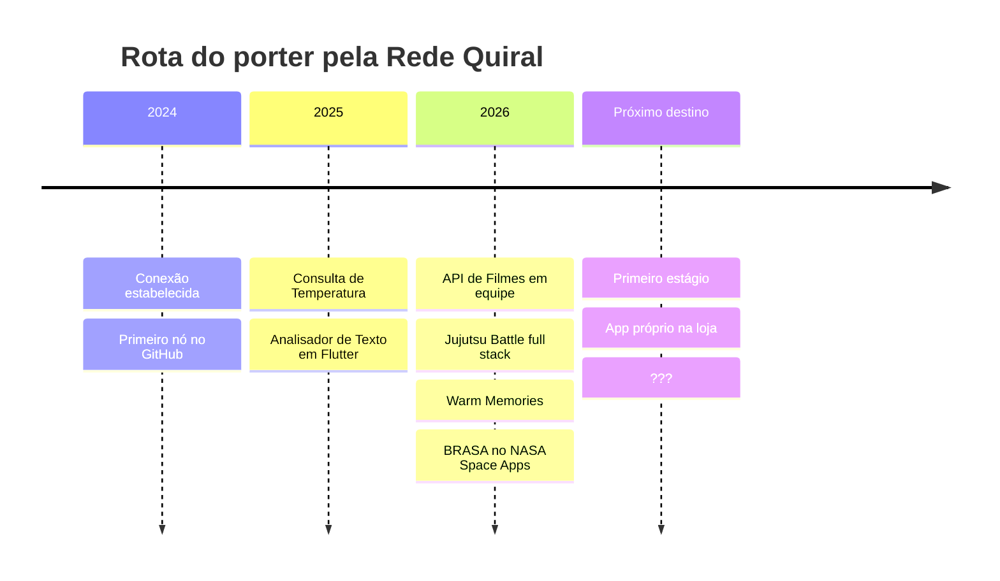

## 🧭 Ordens de entrega ativas

- [x] Entregar o **BRASA** no NASA Space Apps Challenge 2026 🔥🛰️
- [x] Ligar um front em React a um back em Spring Boot sem perder a carga
- [x] Publicar um template open source que qualquer pessoa pode reutilizar
- [ ] Concluir Sistemas de Informação 🎓
- [ ] Lançar um app mobile próprio na loja 📱
- [ ] Conseguir o segundo estágio em desenvolvimento ← **você pode ajudar nessa**


## 🌧️ Previsão de timefall

<div align="center">
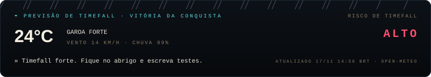
<br/><sub>Clima real do meu nó de origem, atualizado todo dia pelo <b>Chiral Sync</b>. (Sim, quem fez o <a href="https://github.com/Tepanniaky/Consulta-de-Temperatura">Consulta de Temperatura</a> não ia deixar isso de fora.)</sub>
</div>

## 📜 Registro de entregas

<!--DELIVERIES:START-->
```diff
# LOG DA REDE QUIRAL · sincronizado em 20/11/2026 14:23 BRT
+ [15/11/2026 13:41] Projeto-Brasa-Hackaton-NASA ..... EM TRÂNSITO
  [17/08/2026 22:09] jujutsu-battle .................. ENTREGUE ✔
  [17/08/2026 21:28] Warm-memories-template .......... ENTREGUE ✔
  [17/08/2026 16:22] api-filmes-avaliacoes ........... ENTREGUE ✔
  [24/11/2025 21:13] analisador-texto-flutter ........ ENTREGUE ✔
```
<!--DELIVERIES:END-->

## 🐍 Um BT seguindo meu rastro de commits

<div align="center">
<picture>
  <source media="(prefers-color-scheme: dark)" srcset="https://raw.githubusercontent.com/Tepanniaky/Tepanniaky/output/chiral-snake-dark.svg"/>
  <source media="(prefers-color-scheme: light)" srcset="https://raw.githubusercontent.com/Tepanniaky/Tepanniaky/output/chiral-snake.svg"/>
  
</picture>
<br/><sub>Cada quadrado dourado é uma pegada. Se o BT comer todos, é hora de commitar de novo.</sub>
</div>


## 🎲 Segredos escondidos na rota

<details>
<summary><b>📟 Abrir o terminal do Odradek</b></summary>

```console
porter@bridges:~$ odradek --scan ze-filho
[scan] alvo identificado: Zé Filho (@Tepanniaky)
[scan] classe ............ Full Stack em formação
[scan] combustível ....... café ☕ + curiosidade
[scan] maior entrega ..... BRASA: 417 municípios, 23 anos de satélite
[scan] carga mais fofa ... Warm Memories 💌
[scan] carga mais brava .. Jujutsu Battle (a maldição regenera, cuidado)
[scan] ponto fraco ....... não consegue parar de refatorar
[scan] resultado: ✔ porter confiável. recomendado para contratação.

porter@bridges:~$ sudo make coffee
[sudo] senha para porter: ********
☕ entrega concluída. +1 Like.
```

</details>

<details>
<summary><b>🍼 Ver o status do pod</b></summary>

```text
      .-""""-.
     /  .--.  \        STATUS DO POD .......... ESTÁVEL
    |  ( ^^ )  |       HUMOR .................. 😊 feliz
    |   '--'   |       ÚLTIMO BUILD ........... ✔ passou
     \  ~~~~  /        MOTIVO DA FELICIDADE ... alguém abriu este README
      '-....-'
```

*Pode ficar tranquilo. Ninguém chora quando os testes passam.*

</details>

<details>
<summary><b>⬆️⬆️⬇️⬇️⬅️➡️⬅️➡️🅱️🅰️</b></summary>
<br/>

> 🏆 **Conquista desbloqueada: "Explorador da Rede"**
> Você abriu todos os segredos do perfil. Como recompensa, este porter te deve um **Like**.
> Para resgatar, deixe uma ⭐ em qualquer repositório e eu retribuo. Combinado é combinado.

</details>


## 📨 Solicitar entrega

Toda conexão começa com um pedido. Escolha o tipo e o e-mail já vai preenchido:

<div align="center">

<a href="mailto:ze-fio@hotmail.com?subject=%F0%9F%93%A6%20Pedido%20de%20entrega%3A%20oportunidade%20de%20est%C3%A1gio&body=Ol%C3%A1%20Z%C3%A9%2C%20vi%20seu%20perfil%20e%20gostaria%20de%20conversar%20sobre%20uma%20vaga..."></a>&nbsp;<a href="mailto:ze-fio@hotmail.com?subject=%F0%9F%A4%9D%20Conectar%20%C3%A0%20Rede%20Quiral%3A%20colabora%C3%A7%C3%A3o&body=Ol%C3%A1%20Z%C3%A9%2C%20tenho%20uma%20ideia%20de%20projeto..."></a>&nbsp;<a href="https://github.com/Tepanniaky?tab=followers"></a>

<sub>Na rede, Likes são a única moeda que importa. Seguir o perfil ou dar ⭐ num repositório conta.</sub>


<sub>Fan-tribute ao clima de <i>Death Stranding 2</i>: todas as artes são originais, feitas em SVG para este perfil. Atualizado automaticamente pelo <code>chiral-sync</code>.</sub>

</div>
